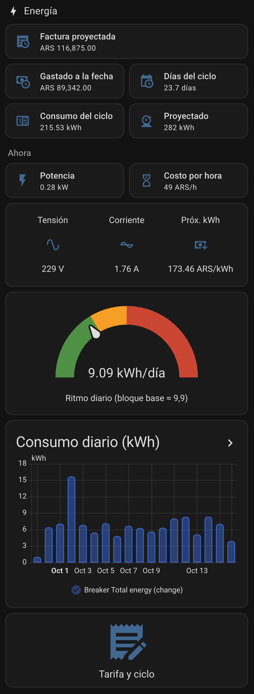

# ⚡ Factura eléctrica para Home Assistant

> **English summary:** A Home Assistant package that estimates your electricity bill in real time for tariffs made of *daily fixed charge + two-tier energy price + per-kWh surcharge + % taxes + flat fee* (the structure used by Argentine residential tariffs such as Edelap T1R2). It gives you the bill so far, the projected bill for the cycle, your daily pace versus the tier limit, the price of your next kWh and the cost per hour of what is running right now. You only change **two sensor names** in one file and load your tariff from a small YAML. Native cards only, no HACS. Docs are in Spanish; the YAML is commented and the tariff files are plug-and-play, so it should be easy to adapt to other countries with the same bill structure. PRs with new tariffs are welcome.

Estimá en tiempo real cuánto te va a llegar de luz, mirando el consumo que ya medís en Home Assistant.

Lo armé para mi casa (Edelap, La Plata, categoría T1R2) y lo dejé genérico para que cualquiera en Argentina —o donde la factura tenga esta estructura— lo use con su propia tarifa.

<p align="center"></p>

## Qué te muestra

- **Factura proyectada** del ciclo, según tu ritmo de consumo actual.
- **Gastado a la fecha** en pesos.
- **Ritmo diario** (kWh/día) contra el límite del bloque base: te avisa en color cuándo estás por pasar al precio más caro.
- **Precio del próximo kWh** (con impuestos) y **costo por hora** de lo que está funcionando ahora.
- Gráfico de consumo diario de los últimos 35 días.
- Una pantalla para cargar la tarifa y reiniciar el ciclo.

## Qué necesitás

0. **Home Assistant 2024.8 o más nuevo** (usa vistas `sections` y la sintaxis `action:`).
1. Home Assistant con un sensor de **energía acumulada en kWh** (medidor inteligente, térmica Tuya/Shelly, pinza amperométrica, Sonoff POW, etc.). Idealmente también uno de potencia instantánea (opcional).
2. Tu última factura, para sacar los valores de la tarifa ([guía](docs/como-leer-tu-factura.md)).

## Instalación rápida (10 minutos)

1. En `configuration.yaml` verificá que tengas:
   ```yaml
   homeassistant:
     packages: !include_dir_named packages
   ```
2. Copiá `packages/factura_electrica.yaml` a `/config/packages/`.
3. Abrilo y cambiá `sensor.mi_medidor_energia_total` y `sensor.mi_medidor_potencia` por tus sensores (buscar y reemplazar).
4. Copiá un archivo de `tarifas/` (o armá el tuyo desde `_plantilla.yaml`) a `/config/packages/`.
5. Reiniciá Home Assistant.
6. Creá el tablero con `dashboard/energia.yaml`.
7. En el tablero: **Tarifa y ciclo → Cargar tarifa del archivo**, y el día de la lectura de tu medidor, **Iniciar nuevo ciclo**.

Detalle paso a paso: [docs/instalacion.md](docs/instalacion.md). Hardware con el que lo probé y alternativas: [docs/hardware.md](docs/hardware.md).

## Cómo calcula

```
umbral  = límite_bloque × días / 30,4167
neto    = cargo_fijo × días
        + precio_base × min(kWh, umbral)
        + precio_excedente × max(kWh − umbral, 0)
        + cargo_por_kWh × kWh
total   = neto × (1 + impuestos %) + tasa_fija
```

Podés validarlo con tu propia factura usando [`herramientas/calcular_factura.py`](herramientas/calcular_factura.py):

```
python3 herramientas/calcular_factura.py --kwh 550 --dias 32 --total-factura 183951.67
```

Con la factura real con la que lo calibré (550 kWh en 32 días) el modelo da una diferencia de **+0,4 %**.

## Limitaciones (leelas)

- Es una **estimación**, no la factura. Probado con **una sola factura** T1R2 de Edelap.
- Asumí que el cargo "CTT" se cobra por kWh; no pude confirmarlo con la distribuidora.
- Las tarifas, subsidios y categorías cambian seguido: hay que cargar la tarifa nueva cuando cambie. Si tu categoría tiene otra estructura (demanda, horarios, bonificaciones), el modelo no la cubre tal cual.
- Si tu sensor no mide **toda** la casa, o empezaste a medir a mitad de un ciclo, usá "kWh no medidos" para corregirlo.
- Reiniciá el ciclo **solo el día que la distribuidora toma la lectura**.

Más casos en [docs/problemas-comunes.md](docs/problemas-comunes.md).

## Contribuir

¿Tenés otra distribuidora o categoría (EDESUR, EDENOR, EPEC, EPE...)? Copiá `tarifas/_plantilla.yaml`, completalo y mandá un Pull Request **sin datos personales** (nada de número de cliente ni de medidor). Si el modelo no te cierra con tu factura, abrí un Issue con la estructura (sin montos personales) y lo vemos.

## Versiones

Ver [CHANGELOG.md](CHANGELOG.md).

## Licencia

[MIT](LICENSE): podés usarlo, copiarlo, modificarlo y compartirlo gratis, incluso con fines comerciales, siempre que mantengas el aviso de copyright (la mención a taito8) en las copias. Sin garantía.
